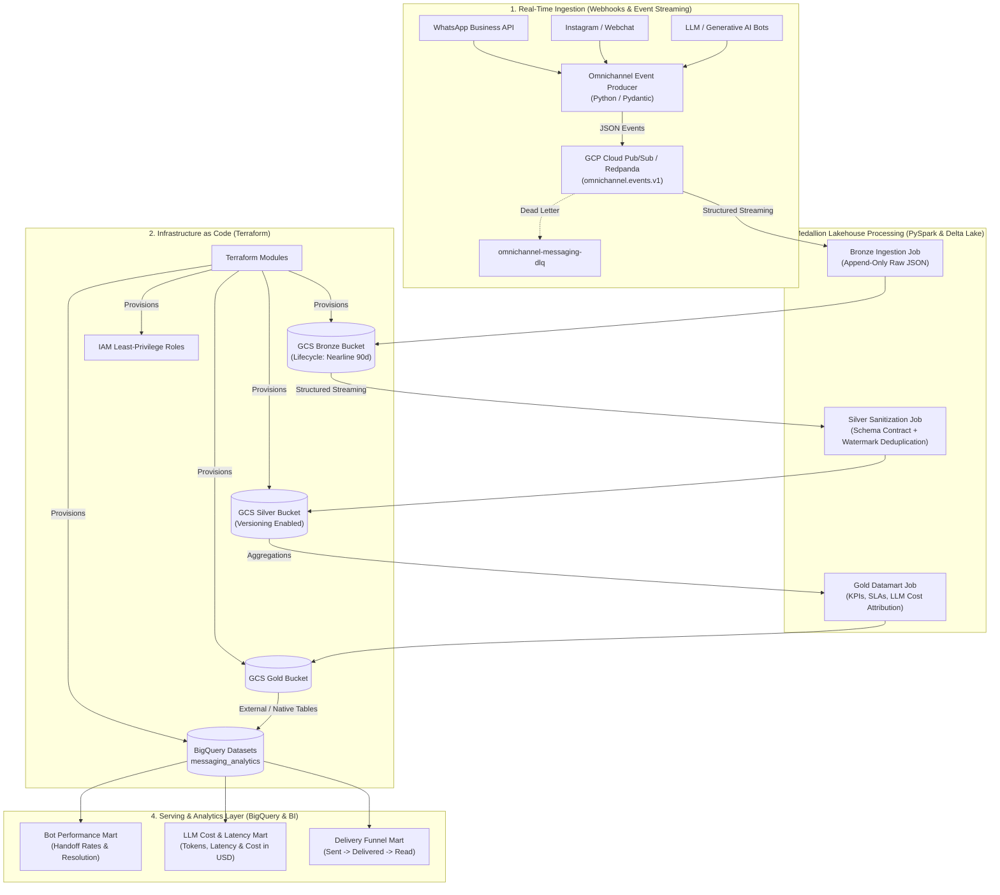

# Real-Time Omnichannel Messaging Lakehouse (GCP & Medallion Architecture)

[](https://cloud.google.com/)
[](https://www.terraform.io/)
[](https://redpanda.com/)
[](https://spark.apache.org/)
[](https://delta.io/)
[](https://cloud.google.com/bigquery)
[](https://www.docker.com/)

An enterprise-grade, end-to-end **Real-Time Streaming Lakehouse** architected for high-velocity conversational messaging platforms (e.g., WhatsApp Business API, Instagram Direct, and Webchat). 

This platform demonstrates the architectural modernization and migration from legacy monolithic cloud stacks (Azure / Databricks) to a cloud-native, decoupled, cost-optimized **Modern Lakehouse on Google Cloud Platform (GCP)**—featuring Infrastructure as Code (**Terraform**), distributed real-time streaming (**PySpark + Kafka/PubSub**), transactional storage (**Delta Lake**), and analytical serving (**BigQuery**).

---

## Architecture Overview



---

## Engineering Highlights

### 1. Cloud Modernization: Azure/Databricks to GCP
* **Decoupled Storage & Compute:** Replaced vendor-locked compute instances with serverless GCS object storage and ephemeral Dataproc/PySpark clusters, drastically reducing idle cluster overhead.
* **Storage Tiering (FinOps):** Raw Bronze dumps automatically transition to `NEARLINE` storage after 90 days via Terraform lifecycle rules, cutting cloud storage costs by ~50%.
* **Zero-Copy Serving:** Materialized Gold Delta/Parquet tables are surfaced directly into **Google Cloud BigQuery**, allowing BI analysts to query petabyte-scale data without redundant ETL copies.

### 2. Medallion Architecture Pattern
* **Bronze Layer (Raw):** Append-only raw JSON payloads with ingest audit timestamps (`ingested_at`, `ingest_date`). Preserves the immutable ground truth for auditability and replayability.
* **Silver Layer (Cleaned & Conformed):**
  * Applies strict contract validation using Pydantic and Spark StructTypes.
  * Employs **15-minute tumbling watermarks** and deduplication over `event_id` and `timestamp` to resolve duplicate delivery receipts from external providers (e.g., Meta webhooks).
  * Unpacks nested Generative AI telemetry (prompt/completion tokens, model names, latency).
* **Gold Layer (Business Datamarts):**
  * **`mart_bot_performance`:** Handoff-to-human escalation rate, message volume per channel, distinct active sessions.
  * **`mart_llm_cost`:** Real-time token consumption, average inference latency (ms), and cost attribution in USD per bot and model.
  * **`mart_delivery_funnel`:** End-to-end delivery funnel analysis ($Sent \rightarrow Delivered \rightarrow Read$).

### 3. Data Governance & Privacy (LGPD / GDPR)
* User identifiers (phone numbers, contact IDs) are pseudonymized at the ingestion boundary using **SHA-256 salted hashing** (`user_id_hash`), preventing PII from ever reaching downstream analytical layers.

---

## Repository Structure

```plaintext
realtime-messaging-lakehouse/
├── terraform/                       # GCP Infrastructure as Code
│   ├── main.tf                      # GCS Buckets, Pub/Sub topics, BigQuery datasets
│   ├── variables.tf                 # Project parameters and regions
│   ├── iam.tf                       # Service accounts and IAM bindings
│   ├── outputs.tf                   # Exported resource IDs
│   └── terraform.tfvars.example     # Environment variable blueprint
├── streaming/                       # Ingestion & Event Simulation
│   └── producer/
│       ├── schemas.py               # Omnichannel Pydantic data models
│       ├── event_generator.py       # High-throughput synthetic stream producer
│       └── test_schemas.py          # Unit tests for event validation
├── lakehouse/                       # PySpark Medallion Pipelines
│   ├── bronze/
│   │   └── ingest_raw_stream.py     # Kafka/PubSub -> Bronze Delta streaming
│   ├── silver/
│   │   └── transform_silver.py      # Watermarking, deduplication, schema enforcement
│   └── gold/
│       └── aggregate_gold_marts.py  # KPI marts, LLM token metrics, delivery funnels
├── .github/workflows/               # CI/CD DataOps Automation
│   ├── terraform-ci.yml             # Terraform fmt, init, and validate
│   └── spark-tests.yml              # Pytest schema and pipeline logic verification
├── docker-compose.yml               # Local testing sandbox (Redpanda + MinIO)
├── requirements.txt                 # Python dependencies
├── .env.example                     # Environment configuration template
└── README.md                        # Architectural documentation
```

---

## Getting Started: Local Sandbox Simulation

You can test and run this entire platform locally without incurring cloud costs using the included Docker Compose sandbox (Redpanda for Kafka streaming, MinIO for S3/GCS storage emulation, and PySpark).

### 1. Prerequisites
- Docker & Docker Compose
- Python 3.10+

### 2. Environment Setup
```bash
# Clone repository
git clone https://github.com/mksouzza/realtime-messaging-lakehouse.git
cd realtime-messaging-lakehouse

# Setup Python virtual environment
python3 -m venv .venv
source .venv/bin/activate
pip install -r requirements.txt

# Configure environment variables
cp .env.example .env
```

### 3. Launch Local Streaming Infrastructure
```bash
docker compose up -d
```
This spins up:
- **Redpanda Broker:** `localhost:9092`
- **Redpanda Console (Topic UI):** [http://localhost:8085](http://localhost:8085)
- **MinIO Storage Server:** [http://localhost:9001](http://localhost:9001) (`minioadmin` / `minioadmin`)

### 4. Produce Real-Time Omnichannel Events
Run the synthetic event producer to stream messages into Redpanda:
```bash
python streaming/producer/event_generator.py
```

### 5. Execute Medallion Lakehouse Processing
```bash
# Ingest raw stream into Bronze Delta
python lakehouse/bronze/ingest_raw_stream.py

# Transform and deduplicate into Silver Delta
python lakehouse/silver/transform_silver.py

# Compute analytical Gold datamarts
python lakehouse/gold/aggregate_gold_marts.py
```

---

## Cloud Deployment (Google Cloud Platform with Terraform)

To provision the production infrastructure on GCP:

```bash
cd terraform

# Authenticate with Google Cloud
gcloud auth application-default login

# Copy variables template and configure your project ID
cp terraform.tfvars.example terraform.tfvars

# Initialize and deploy
terraform init
terraform plan
terraform apply
```

---

## Data Engineering Portfolio Ecosystem

This project is part of a comprehensive three-pillar Data Engineering portfolio:

1. **[Real-Time Omnichannel Messaging Lakehouse](https://github.com/mksouzza/realtime-messaging-lakehouse)** (Current Project): Streaming, Medallion Lakehouse, PySpark, Delta Lake, and GCP Terraform.
2. **[Commodities Data Warehouse & Analytics Platform](https://github.com/mksouzza/commodities-data-warehouse)**: Batch ELT, dimensional modeling, dbt-core, PostgreSQL, and Streamlit.
3. **[Airflow Data Pipeline Orchestrator](https://github.com/mksouzza/airflow-data-orchestrator)**: Central workflow orchestration, TaskFlow API, failure alerts, SLA monitoring, and Astro CLI.
